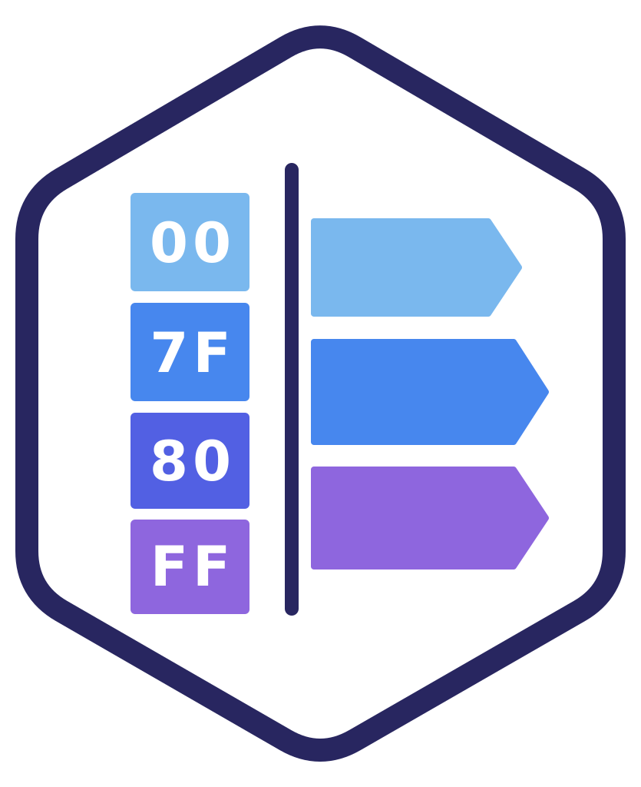

# Lexis

<table><tr>
<td valign="middle" width="160"></td>
<td valign="middle">

Lexis is a fork of ScyllaDB that replaces the Murmur3 partitioner with
byte-ordered partitioning, built on tablets. (ScyllaDB removed its
ByteOrderedPartitioner in 4.0.) The token of a partition is an
order-preserving encoding of its partition key, so partitions are stored and
distributed in key order, and prefix and range queries over partition keys are
served as range reads instead of scattering across the cluster.

</td>
</tr></table>

## The original constraint

ByteOrderedPartitioner was deprecated primarily because ordered partitioning causes severe imbalance when multiple tables have different key distributions. The token boundaries that produce good distribution for one table's key space are wrong for another's. With a cluster-global token ring this is a genuine problem and the objection was reasonable at the time.

The secondary objection, hotspots from sequential writes, reinforced this position.

## Why tablets eliminate the constraint

Tablets give each table its own independent token-range-to-node-and-core mapping. There is no shared token ring across tables. The multi-table distribution problem that was the principal objection to ByteOrderedPartitioner does not exist in a tablets architecture by construction.

The hotspot objection is also addressed. A hot tablet gets split and migrated dynamically by the tablet load balancer. With a sufficiently high-entropy leading key component, writes distribute naturally across the keyspace, and any residual concentration is handled by the load balancer without schema changes. This is the mechanism working as designed.

## What ordered partitioning restores

Prefix scans over contiguous key ranges become possible: queries that currently require secondary indexes become efficient range reads routed to a bounded set of nodes and cores. Partial partition key queries, which under Murmur3 require a full cluster scatter, can be served by contiguous token range lookups. The expressiveness of the query model improves substantially without any sacrifice in distribution or performance.

Secondary indexes and denormalized tables used to work around hash-distributed keys become unnecessary for range-ordered access patterns.

## Prior art

This is the model Google Bigtable has offered since 2004: lexicographic ordering with per-table tablet-based distribution and dynamic splitting. The open source distributed database ecosystem deprecated the one feature that would have given it equivalent query semantics, based on a constraint that modern tablet architectures have already eliminated.

## Why ScyllaDB

ScyllaDB is uniquely positioned to address this. The per-core shared-nothing architecture means a tablet split results in work moving to a specific core on a specific node, so the granularity of load balancing is finer than anything else available. Combining per-table ordered tablets with this architecture would produce something that does not currently exist in any production open source distributed database: Bigtable's query model on modern hardware.

## Approach

Re-enable ordered partitioning as the partitioner for all tables in ScyllaDB's tablet architecture. The tablet load balancer handles distribution and its splitting heuristics evolve iteratively on top of this foundation.

## Motivation

Hierarchical keys are a common pattern: document stores, file and object
stores, and multi-tenant data all address records by a path. For example, a
document store with each document at
`/collection/{collectionId}/documents/{documentId}`, and the whole path as the
partition key:

    CREATE TABLE docs (coll text, colid text, docid text, body text,
                       PRIMARY KEY ((coll, colid, docid)));

     coll       | colid | docid | body
    ------------+-------+-------+------
     collection | c1    | d1    | x
     collection | c1    | d2    | y
     collection | c42   | d100  | a
     collection | c42   | d101  | b
     collection | c42   | d250  | c
     users      | u7    | p1    | z

In ScyllaDB the token is a hash of the whole path, so only a complete path can
be looked up efficiently. Listing a collection, paging through it, or listing
collections all name just the start of a path, and ScyllaDB rejects them:

    Cannot execute this query as it might involve data filtering and thus may have unpredictable performance. If you want to execute this query despite the performance unpredictability, use ALLOW FILTERING

or, for a range on part of the path:

    Only EQ and IN relation are supported on the partition key (unless you use the token() function or allow filtering)

With ALLOW FILTERING they run as full scans of every node and return rows in
hash order. The usual workarounds are a secondary index, a second table keyed
for each access pattern, or moving docid into a clustering column, which puts
a whole collection into one partition that cannot be split.

In Lexis the token is the path itself, encoded so that byte order is path
order. Documents that share a prefix are stored together, so each of these
patterns becomes a read of one contiguous range of tablets, in path order,
without ALLOW FILTERING:

**All documents in one collection:**

    SELECT * FROM docs WHERE coll = 'collection' AND colid = 'c42';

     collection | c42   | d100  | a
     collection | c42   | d101  | b
     collection | c42   | d250  | c

**Every collection under a path:**

    SELECT * FROM docs WHERE coll = 'collection';

     collection | c1    | d1    | x
     collection | c1    | d2    | y
     collection | c42   | d100  | a
     collection | c42   | d101  | b
     collection | c42   | d250  | c

**A page of documents, resuming after the last one seen:**

    SELECT * FROM docs WHERE coll = 'collection' AND colid = 'c42'
        AND docid > 'd100' LIMIT 2;

     collection | c42   | d101  | b
     collection | c42   | d250  | c

**A range of collections:**

    SELECT * FROM docs WHERE coll = 'collection' AND colid >= 'c1' AND colid < 'c2';

     collection | c1    | d1    | x
     collection | c1    | d2    | y

**Several collections at once:**

    SELECT * FROM docs WHERE coll = 'collection' AND colid IN ('c1', 'c42');

     collection | c1    | d1    | x
     collection | c1    | d2    | y
     collection | c42   | d100  | a
     collection | c42   | d101  | b
     collection | c42   | d250  | c

**Several collections at once, from a given document on:**

    collection / c42 / *                 ok: all documents in c42
    collection / c42 / d100..d200        ok: a range at the end
    collection / {c1, c42} / d100..*     ok: two paths, each ending in a range
    collection / * / d100                not ok: a gap in the middle, so the
                                         matches are not next to each other

    SELECT * FROM docs WHERE coll = 'collection' AND colid IN ('c1', 'c42')
        AND docid > 'd1';

     collection | c1    | d2    | y
     collection | c42   | d100  | a
     collection | c42   | d101  | b
     collection | c42   | d250  | c

d1 is excluded, and since 'd100' > 'd1' in text order, all of c42 is included.

**The first rows of the whole table, in key order** (in ScyllaDB, LIMIT returns
whichever rows hash first):

    SELECT * FROM docs LIMIT 2;

     collection | c1    | d1    | x
     collection | c1    | d2    | y

## Components

| Repository | Docker image |
|---|---|
| [lexisdb](https://github.com/jk89/lexisdb) (this repository, the database) | `0x6a6f6e6e79/lexisdb` |
| [lexis-python-driver](https://github.com/jk89/lexis-python-driver) | |
| [lexis-rust-driver](https://github.com/jk89/lexis-rust-driver) | |
| [lexis-cqlsh](https://github.com/jk89/lexis-cqlsh) | `0x6a6f6e6e79/lexis-cqlsh` |
| [lexis-tools-java](https://github.com/jk89/lexis-tools-java) | `0x6a6f6e6e79/lexis-tools-java` |
| [lexis-jmx](https://github.com/jk89/lexis-jmx) | `0x6a6f6e6e79/lexis-jmx` |

Run a single node:

    docker run --name lexisdb -d 0x6a6f6e6e79/lexisdb

## Building

Lexis builds with the standard ScyllaDB toolchain container. See
[guide-build-and-test.md](guide-build-and-test.md); upstream's build
documentation is in [HACKING.md](HACKING.md).

## Base and licence

Lexis is forked from `scylla-6.2.3` (commit `bff9ddde12`, 2025-01-19), the
last tagged open-source ScyllaDB release, which is licensed under the GNU
AGPL ([LICENSE.AGPL](LICENSE.AGPL)). From `branch-2025.1` onward, ScyllaDB is
under the source-available ScyllaDB Software License. Lexis is licensed
AGPL-3.0-or-later.

The upstream ScyllaDB README is kept unchanged in [README_SCYLLA.md](README_SCYLLA.md).
